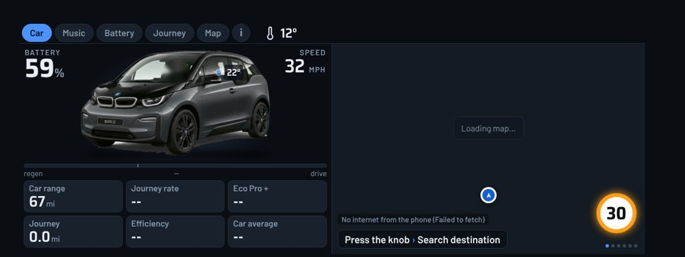
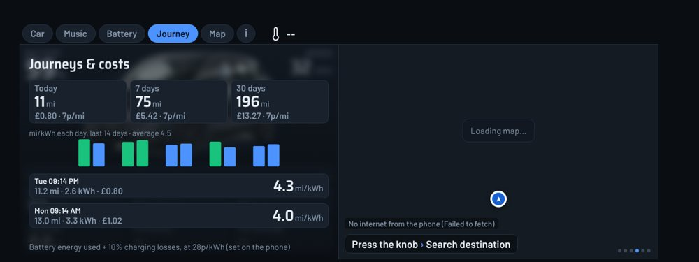
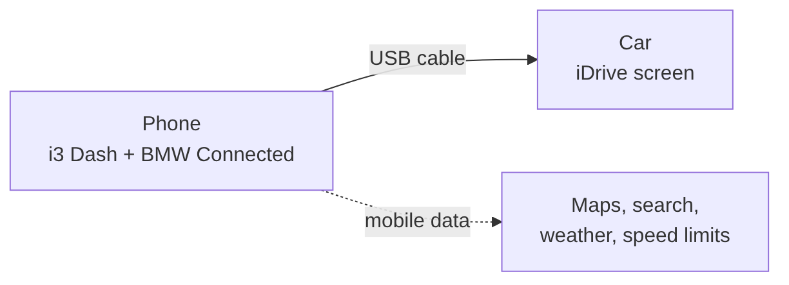
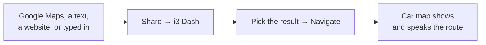
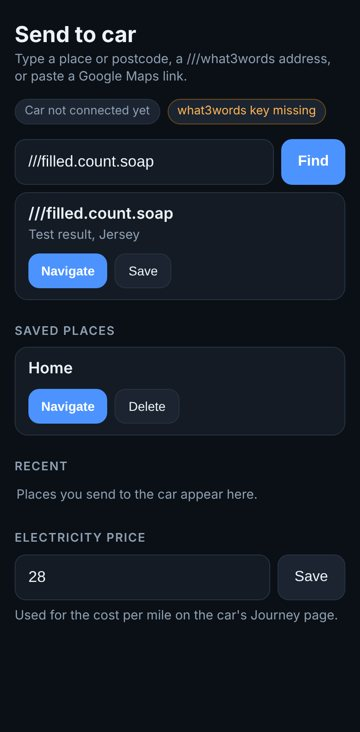

# i3 Dash

A custom dashboard for the BMW i3's iDrive screen, driven by your Android phone.

It adds one app to the car's menu showing battery, range, speed, music, journey costs and a map. You can also send a destination from your phone and have the route start on the car.

*Car page, with sample numbers. The map is blank because the screenshot was taken without internet.*

This is a personal fork of [AAIdrive](https://github.com/BimmerGestalt/AAIdrive) by Walter Huf and contributors (MIT licence). It is not made, endorsed or supported by BMW. The original project's README is kept in [docs/UPSTREAM.md](docs/UPSTREAM.md).

## What you get

| Page | What it shows |
|---|---|
| **Car** | Battery, speed, range, journey figures, tyre rings that colour only when a tyre is low, and the map. |
| **Music** | Now playing with artwork from Spotify, Amazon Music, Apple Music or BBC Sounds. |
| **Battery** | Charge, range and the nearest charger. |
| **Journey** | Miles, cost and efficiency for today, 7 days and 30 days, a 14 day chart and recent trips. |
| **Map** | Dark 3D map, routing with spoken directions, live speed limit with an over-limit warning, and chargers. |
| **i** | Connection details and the raw data the car sends. |

Incoming calls show a panel with the caller's name. Answering is still done from the car.

## What you need

- A BMW i3 with the wide iDrive screen (built for NBT, iDrive 4). Only tested on one car.
- An Android phone, a USB cable and mobile data.
- The BMW Connected app (MyBMW), installed and signed in.

## Install

1. On your phone, download `i3-dash.apk` from the [`i3dash-latest` release](https://github.com/uknsaunders/AAIdrive/releases/tag/i3dash-latest).
2. Allow installs from your browser when Android asks, then open the file and tap Install. Uninstall the original AAIdrive first, because they share an app ID.
3. Open the app and work through the welcome screens.
4. Allow notification access so it can read what is playing and show calls. If the switch is greyed out, go to Settings → Apps → i3 Dash → ⋮ → **Allow restricted settings**, then try again.

## Connect

1. Plug the phone into the car's USB port.
2. Open the app. The card at the top shows three ticks: phone linked, car link ready, connected.
3. If it stops partway, the card shows a hint. A common one is switching the phone's USB mode from charging to file transfer.
4. On the car, open the apps menu and choose **i3 Dash**.

If it sits on "waiting for car connection", close the BMW Connected app, restart the phone and the car, then plug in again.

## Using it in the car

Turn the iDrive knob to move between pages. Press the knob on the map to open the menu, which includes search.

For music, start a song on the phone. If the radio keeps playing, press MEDIA on the car to switch the source to the phone.

## Send a place from your phone

Share a place from Google Maps or any app and choose **i3 Dash**, or open the app and tap **Send to car**. You can type a place, a postcode, a `///three.word.address`, or paste a link. If the car is not showing i3 Dash yet, the destination waits and starts when it appears. Tap **Save** to keep places like Home and Work, which also show up when you search from the car.

### what3words

what3words needs a free API key from what3words. If you build your own copy, add it as a repository secret named `W3W_API_KEY` (Settings → Secrets and variables → Actions) and run the build again. Until then the app shows "key missing" and `///words` will not resolve.

## Phone app

The home screen has a connection card at the top and a list of large buttons: Send to car, Music, Notifications, Navigation, Calendar, Assistants, Car information, Addons, Settings and Support. Tap one to open it and use the back arrow to return.

## Things to know

- Journey cost is the battery energy used plus 10% for charging losses, at your price per kWh. The default is 28p, and you can change it on the Send to car screen.
- Speed limits and chargers come from OpenStreetMap, so some roads have no limit listed.
- Not yet confirmed on a real car: opening search from the knob press, tyre pressure values (see the Tyres line on the **i** page), and the label under the car's menu icon.
- Calls are display only.

## Building

GitHub Actions builds the app on every push to `main` (`.github/workflows/i3dash.yml`) and publishes `i3-dash.apk` to the `i3dash-latest` release. It is signed with a personal debug key, `i3dash-debug.keystore`, so updates install over each other.

## Credits and licence

Built on [AAIdrive](https://github.com/BimmerGestalt/AAIdrive) and the BimmerGestalt libraries. Maps use OpenFreeMap and OpenStreetMap data, routing uses OSRM, and weather uses Open-Meteo. MIT licensed, see [LICENSE](LICENSE).
