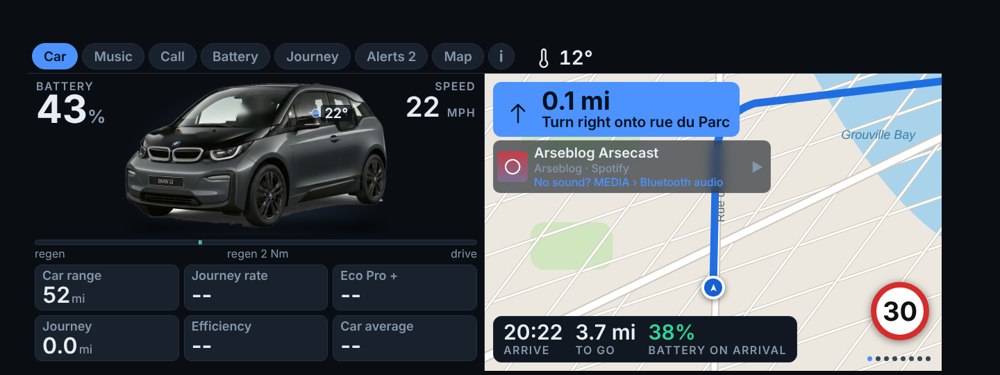
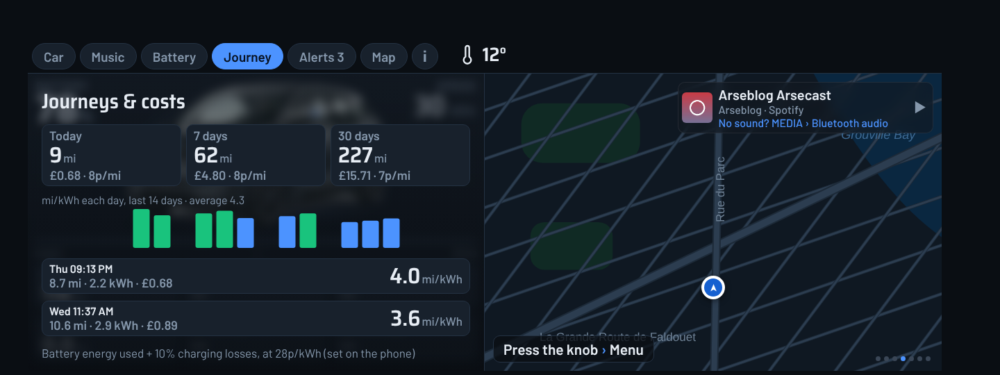
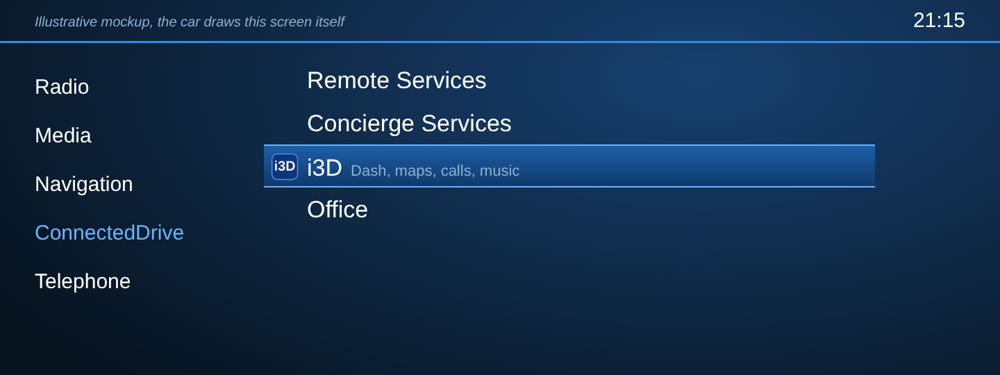
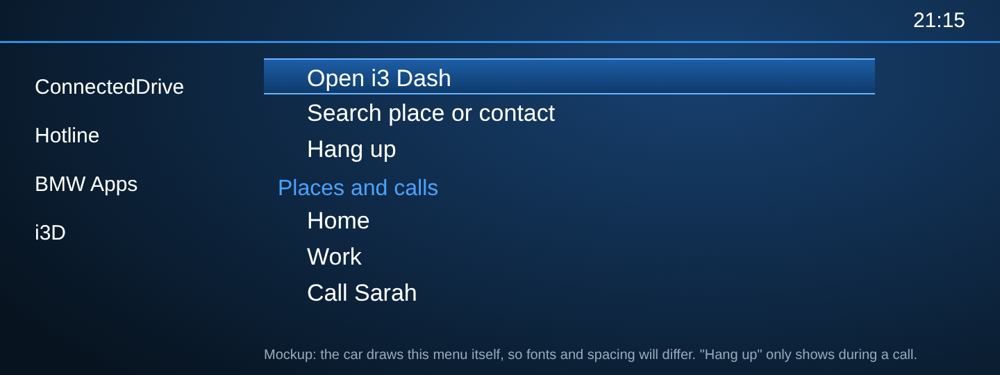
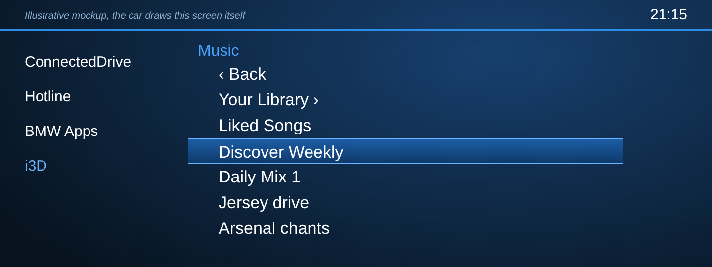
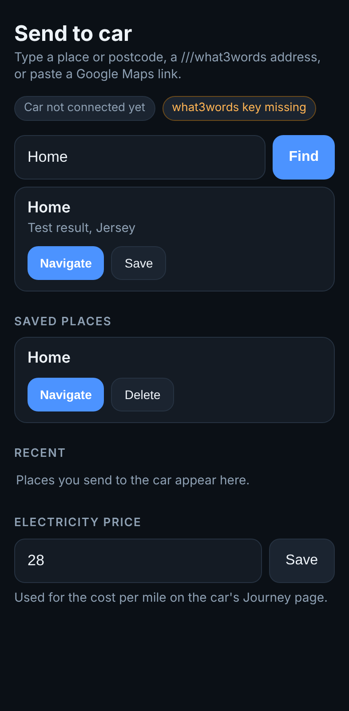
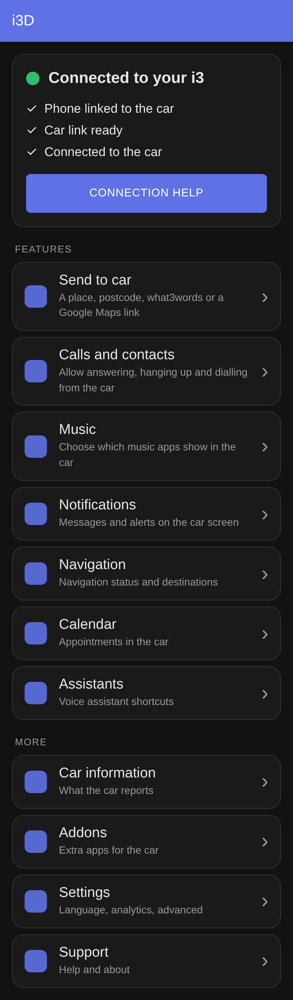

# i3 Dash (the i3D app)

A custom dashboard for the BMW i3's iDrive screen, driven by your Android phone.

It adds one app to the car's menu, called **i3D**. It shows battery, range, speed, music, phone alerts, journey costs and a map. You can answer and make calls, pick music, and send a destination from your phone so the route starts on the car.

*Sample numbers. The map is drawn for the picture, the real one is live. [More pictures of every page](docs/SCREENSHOTS.md).*

This is a personal fork of [AAIdrive](https://github.com/BimmerGestalt/AAIdrive) by Walter Huf and contributors (MIT licence). It is not made, endorsed or supported by BMW. The original project's README is kept in [docs/UPSTREAM.md](docs/UPSTREAM.md).

## What you get

| Page | What it shows |
|---|---|
| **Car** | Battery, speed, range, journey figures, tyre rings that colour only when a tyre is low, and the map. |
| **Music** | Now playing with artwork from Spotify, Amazon Music, Apple Music or BBC Sounds. Pick another app or playlist from the car menu (see below). |
| **Battery** | Charge, range and the nearest charger. |
| **Alerts** | Your recent phone notifications, newest first, with a count on the tab. |
| **Journey** | Miles, cost and efficiency for today, 7 days and 30 days, a 14 day chart and recent trips. |
| **Map** | Dark 3D map, routing with spoken directions, live speed limit with an over-limit warning, and chargers. |
| **i** | Connection details and the raw data the car sends. |

Incoming calls show a panel with the caller's name. Press the knob to **Answer call** or **Hang up**. To ring someone, choose **Search** and type a name, or "call" and a name, then pick the "Call …" row. Allow calls once with the **Calls and contacts** button in the phone app.

## What you need

- A BMW i3 with the wide iDrive screen (built for NBT, iDrive 4). Only tested on one car.
- An Android phone, a USB cable and mobile data.
- The BMW Connected app (MyBMW), installed and signed in.

## Install

1. On your phone, download `i3-dash.apk` from the [`i3dash-latest` release](https://github.com/uknsaunders/idash/releases/tag/i3dash-latest).
2. Allow installs from your browser when Android asks, then open the file and tap Install. The app is called **i3D** on your phone. It has its own app ID, so it installs next to the original AAIdrive instead of replacing it. Only run one of them at a time, because both try to connect to the car. If you installed an earlier i3 Dash build (before 12 November 2026), uninstall it once i3D works. It was a different app, so settings and saved places do not carry over, and you need to allow notification access and calls again.
3. Open i3D and work through the welcome screens.
4. Allow notification access so it can read what is playing and show alerts and calls. If the switch is greyed out, go to Settings → Apps → i3D → ⋮ → **Allow restricted settings**, then try again.
5. Tap **Calls and contacts** on the home screen and allow the permissions, so the car can answer, hang up and dial.

## Connect

1. Plug the phone into the car's USB port.
2. Open the app. The card at the top shows three ticks: phone linked, car link ready, connected.
3. If it stops partway, the card shows a hint. A common one is switching the phone's USB mode from charging to file transfer.
4. On the car, open **ConnectedDrive** and choose **i3D**, the icon with the blue and yellow ring.

*An illustration of the entry. The car draws its own menu, so yours will look a little different, and the label under the icon may not show on every car.*

If it sits on "waiting for car connection", close the BMW Connected app, restart the phone and the car, then plug in again.

## Using it in the car

Turn the iDrive knob to move between pages. Press the knob to open the i3D menu.

The menu has:

- **Open i3 Dash**, to go back to the dashboard.
- **Search place or contact**, to start navigating or ring someone.
- **Answer call** or **Hang up**, only while the phone is ringing or in a call.
- **Places and calls**, your saved places and starred contacts. Press one to navigate or ring.
- **Music**, to pick an app and a playlist.

### Music

Start a song on the phone and it shows on the Music page. If the radio keeps playing, press MEDIA on the car to switch the source to the phone.

To choose something from the car, press the knob, scroll to **Music** and press an app. Its library opens, with playlists, liked songs and albums. Press a playlist to play it. The first row, **Back**, goes up a level.

What you see in a library depends on the app, and some apps share less than others. The music picker has not been tried in a car yet.

## Send a place from your phone

Share a place from Google Maps or any app and choose **i3 Dash**, or open the app and tap **Send to car**. You can type a place, a postcode, a `///three.word.address`, or paste a link. If the car is not showing i3 Dash yet, the destination waits and starts when it appears. Tap **Save** to keep places like Home and Work, which also show up when you search from the car.

### what3words

what3words needs a free API key from what3words. If you build your own copy, add it as a repository secret named `W3W_API_KEY` (Settings → Secrets and variables → Actions) and run the build again. Until then the app shows "key missing" and `///words` will not resolve.

## Phone app

The home screen has a connection card at the top and a list of large buttons: Send to car, Calls and contacts, Music, Notifications, Navigation, Calendar, Assistants, then Car information, Addons, Settings and Support. Tap one to open it and use the back arrow to return.

## Things to know

- Journey cost is the battery energy used plus 10% for charging losses, at your price per kWh. The default is 28p, and you can change it on the Send to car screen.
- Speed limits and chargers come from OpenStreetMap, so some roads have no limit listed.
- Not yet confirmed on a real car: the music picker, answering, hanging up and dialling from the menu, whether the page header now clears the car's own logo and status bar, opening search from the knob press, and the label under the car's menu icon.
- This i3 sends no tyre pressure data, so the tyre rings stay empty (see the Tyres line on the **i** page).

## Building

GitHub Actions builds the app on every push to `main` (`.github/workflows/i3dash.yml`) and publishes `i3-dash.apk` to the `i3dash-latest` release. It is signed with a personal debug key, `i3dash-debug.keystore`, so updates install over each other.

## Changes

See the [changelog](CHANGELOG.md).

## Credits and licence

Built on [AAIdrive](https://github.com/BimmerGestalt/AAIdrive) and the BimmerGestalt libraries. Maps use OpenFreeMap and OpenStreetMap data, routing uses OSRM, and weather uses Open-Meteo. MIT licensed, see [LICENSE](LICENSE).

Pictures of every page: [docs/SCREENSHOTS.md](docs/SCREENSHOTS.md)
