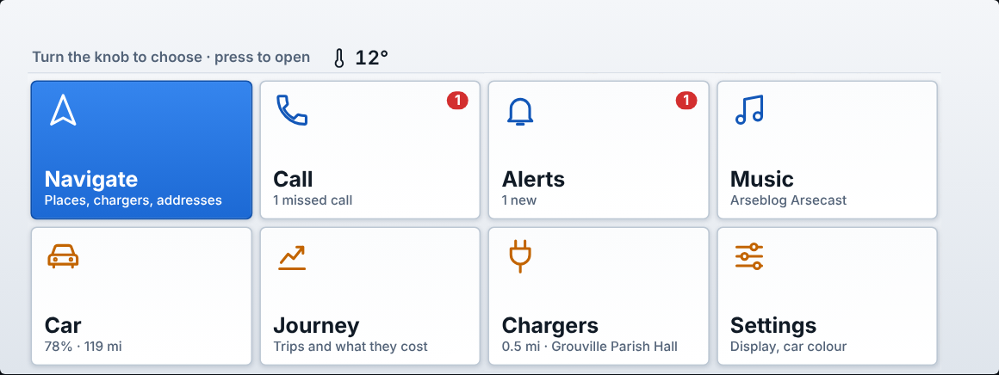
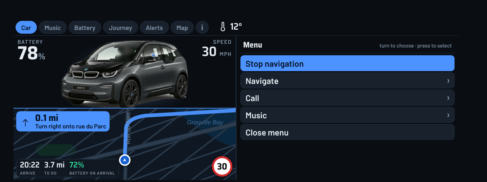
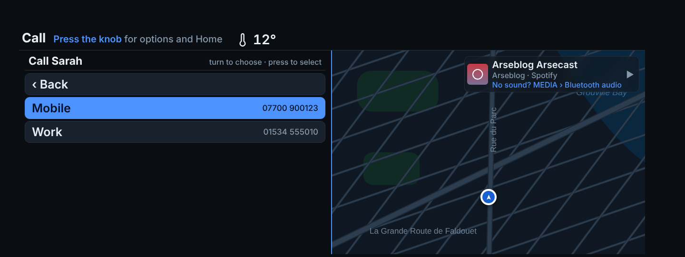
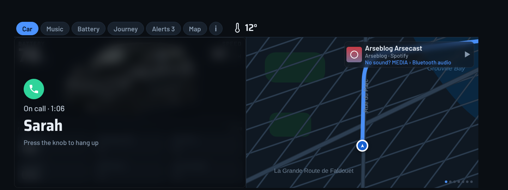

# i3 Dash (the i3D app)

A custom dashboard for the BMW i3's iDrive screen, driven by your Android phone.

It adds one app to the car's menu, called **i3D**. It shows battery, range, speed, music, phone alerts, journey costs and a map. You can answer and make calls, pick music, and send a destination from your phone so the route starts on the car.

*Sample numbers. The map is drawn for the picture, the real one is live. [More pictures of every page](docs/SCREENSHOTS.md).*

This is a personal fork of [AAIdrive](https://github.com/BimmerGestalt/AAIdrive) by Walter Huf and contributors (MIT licence). It is not made, endorsed or supported by BMW. The original project's README is kept in [docs/UPSTREAM.md](docs/UPSTREAM.md).

## What you get

| Page | What it shows |
|---|---|
| **Car** | Battery, speed, range, journey figures, tyre rings that colour only when a tyre is low, and the map. |
| **Music** | Now playing with artwork from Spotify, Amazon Music, Apple Music or BBC Sounds. Pick another app or playlist from the car menu (see below). |
| **Battery** | Charge, range and the nearest charger. |
| **Alerts** | Your recent phone notifications, newest first, with a count on the tab. |
| **Journey** | Miles, cost and efficiency for today, 7 days and 30 days, a 14 day chart and recent trips. |
| **Call** | Favourites, recent calls and all your contacts, dialled from the knob. |
| **Map** | 3D map that is light by day and dark at night, routing with spoken directions, live speed limit with an over-limit warning, and chargers. |
| **i** | Connection details and the raw data the car sends. |

Calls show a panel with the name, number and time. Press the knob to answer, decline or hang up.

## What you need

- A BMW i3 with the wide iDrive screen (built for NBT, iDrive 4). Only tested on one car.
- An Android phone, a USB cable and mobile data.
- The BMW Connected app (MyBMW), installed and signed in.

## Install

1. On your phone, download `i3-dash.apk` from the [`i3dash-latest` release](https://github.com/uknsaunders/idash/releases/tag/i3dash-latest).
2. Allow installs from your browser when Android asks, then open the file and tap Install. The app is called **i3D** on your phone. It has its own app ID, so it installs next to the original AAIdrive instead of replacing it. Only run one of them at a time, because both try to connect to the car. If you installed an earlier i3 Dash build (before 12 November 2026), uninstall it once i3D works. It was a different app, so settings and saved places do not carry over, and you need to allow notification access and calls again.
3. Open i3D and work through the welcome screens.
4. The home screen shows a **Finish setting up** list. Work down it until it disappears.
   - **Music, alerts and calls on the car screen.** Android blocks this switch for apps from outside the Play Store, so the list gives three numbered buttons to tap in order: try the switch, unlock it (three dots at the top right, then **Allow restricted settings**), then switch it on. Each one takes you to the right screen and you come back with the back button.
   - **Calls and contacts** lets the car answer, hang up and dial, and list your favourites and recent calls.

## Connect

1. Plug the phone into the car's USB port.
2. Open the app. The card at the top shows three ticks: phone linked, car link ready, connected.
3. If it stops partway, the card shows a hint. A common one is switching the phone's USB mode from charging to file transfer.
4. On the car, open **ConnectedDrive** and choose **i3D**, the icon with the blue and yellow ring.

*An illustration of the entry. The car draws its own list, so yours will look a little different, and the label under the icon may not show on every car. Choosing it opens the dash directly.*

If it sits on "waiting for car connection", close the BMW Connected app, restart the phone and the car, then plug in again.

## Using it in the car

i3D opens on a home screen with a card for each part: Navigate, Call, Music, Map, Car, Battery, Journey and Alerts. Turn the iDrive knob to choose a card and press to open it.

Each section shows its name at the top, with no row of buttons. Press the knob for that section's list. It opens on the left half and the map stays on the right at full size. Turn to choose, press to select. It closes by itself after 20 seconds.

- **‹ Home screen** starts every list, so you can always get back to the cards. Battery and Journey have nothing to choose, so one press there goes straight home.
- **Navigate** and **Map**: saved places, the nearest charger, recent places, or **Type a place** on the car's letter wheel. Picking a result comes straight back to the dash.
- **Call**: favourites, recent calls, **All contacts**, or type a name. If someone has more than one number, you pick which (Mobile, Work and so on) before it dials.
- **Music**: pause, skip, or choose an app and one of its playlists. Videos you sent from the phone are here too, parked only.
- **Alerts**: **Read alerts aloud** speaks your latest three.
- **Car**: car colour and info.

During a call the dash moves to the Call section and shows who it is, the number, and how long the call has run. Press the knob to hang up. When the phone rings, the same press offers **Answer call** and **Decline call**. While a call is on, every list starts with **Hang up**.

The map is light in daylight and dark at night. It switches by itself from where the sun is.

Three things the car decides, not the app:

- **Sound.** Music travels to the car over Bluetooth, even with the USB cable in. If you hear the radio instead, press MEDIA and choose Bluetooth audio. The car remembers it.
- **The car's phone screen.** The car shows its own screen when a call connects. i3D brings the dash back once the call is under way, showing the call with **Hang up** one press away.
- **The globe at the top left.** The car draws its own ConnectedDrive icon and status bar over every app, and an app cannot remove them. The dash keeps its own content clear of them.

What you see in a music app's library depends on the app, and some apps share less than others.

## Send a place from your phone

Share a place from Google Maps or any app and choose **i3 Dash**, or open the app and tap **Send to car**. You can type a place, a postcode, a `///three.word.address`, or paste a link. If the car is not showing i3 Dash yet, the destination waits and starts when it appears. Tap **Save** to keep places like Home and Work, which also show up when you search from the car.

### YouTube (parked only)

Share a YouTube video or playlist to i3D from the YouTube app, or paste the link into **Send to car**, and tap **Play on car**. It plays on the car screen with sound through the phone, only while the car is standing still. Videos you send are kept in the car's menu under **Video**, so you can start them again without the phone. If the car starts moving it stops and the dashboard comes back, and turning or pressing the knob stops it too. If the car gives no speed reading, video will not start. It has not been tried in a car yet, and YouTube can refuse to play some videos in an embedded player.

### what3words

what3words needs a free API key from what3words. If you build your own copy, add it as a repository secret named `W3W_API_KEY` (Settings → Secrets and variables → Actions) and run the build again. Until then the app shows "key missing" and `///words` will not resolve.

### Better place search (optional)

Out of the box, place search uses OpenStreetMap. It finds addresses, postcodes and well-known places, and it forgives spelling, but it does not know every business.

Add your own Google key and the search works like Google Maps: "cheeky monkies nursery" finds the nursery. It covers both typing in the car and Send to car on the phone.

1. In the [Google Cloud console](https://console.cloud.google.com/), create a project and a billing account. Google asks for a card.
2. Enable **Places API (New)** for the project.
3. Under Credentials, create an **API key** and restrict it to Places API (New).
4. In i3D on the phone, open **Send to car**, paste the key under **Better place search** and tap **Save and test**.

Google's [price list](https://developers.google.com/maps/billing-and-pricing/pricing) gives 5,000 free text searches a month, far more than one car needs. To be certain of no bill, set a daily quota on the key in the console. The key is stored on your phone only and is not part of the app or this repository.

## Phone app

The home screen has a connection card at the top, the setup list until it is finished, and **Send to car**. If the app ever stops unexpectedly, a **Send the report** button appears here next time you open it, so the cause can be found. Car information, Settings and Support are under More. The original AAIdrive apps (Music, Notifications, Navigation, Calendar, Assistants, Addons) are at the bottom. They are optional and each is a separate entry in the car's menus.

## Things to know

- Journey cost is the battery energy used plus 10% for charging losses, at your price per kWh. The default is 28p, and you can change it on the Send to car screen.
- Speed limits and chargers come from OpenStreetMap, so some roads have no limit listed.
- Confirmed in the car on 13 November 2026: the dash opens from ConnectedDrive, the knob turns pages and opens the menu, and the page sits clear of the car's status bar.
- Not yet confirmed on a real car: the sections without buttons, call details and hanging up, choosing between a contact's numbers, the daylight map, the fuller Call list, the music picker, answering and hanging up, the dash coming back during a call, and YouTube. If the dash page ever fails to load, the knob press falls back to the car's plain menu.
- This i3 sends no tyre pressure data, so the tyre rings stay empty (see the Tyres line on the **i** page).

## Building

GitHub Actions builds the app on every push to `main` (`.github/workflows/i3dash.yml`) and publishes `i3-dash.apk` to the `i3dash-latest` release. It is signed with a personal debug key, `i3dash-debug.keystore`, so updates install over each other.

## Changes

See the [changelog](CHANGELOG.md).

## Credits and licence

Built on [AAIdrive](https://github.com/BimmerGestalt/AAIdrive) and the BimmerGestalt libraries. Maps use OpenFreeMap and OpenStreetMap data, routing uses OSRM, and weather uses Open-Meteo. MIT licensed, see [LICENSE](LICENSE).

Pictures of every page: [docs/SCREENSHOTS.md](docs/SCREENSHOTS.md)
