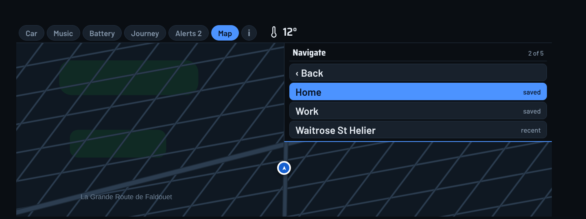
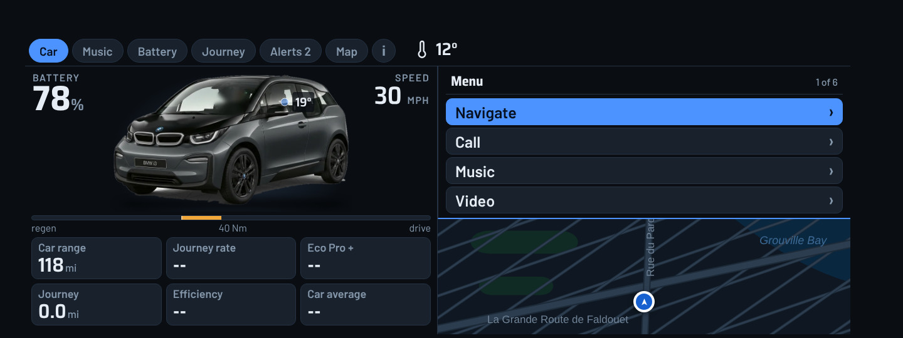
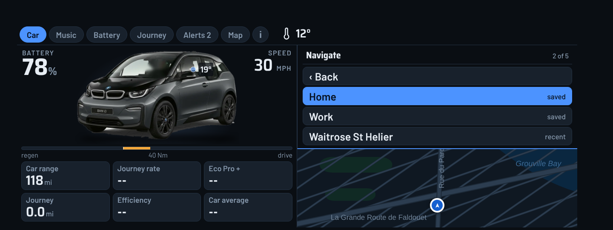
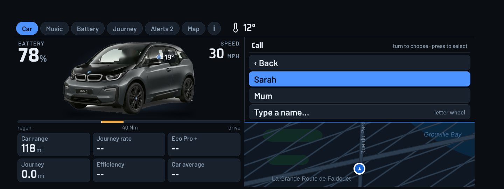
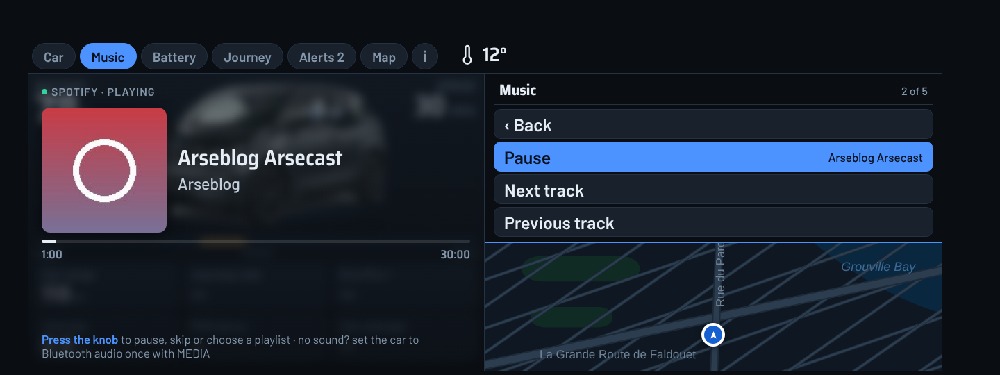
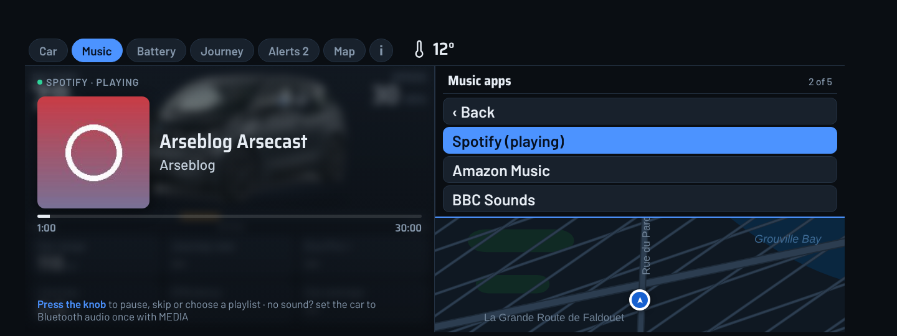
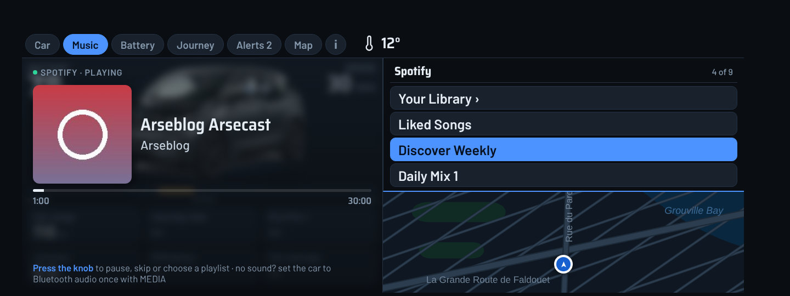
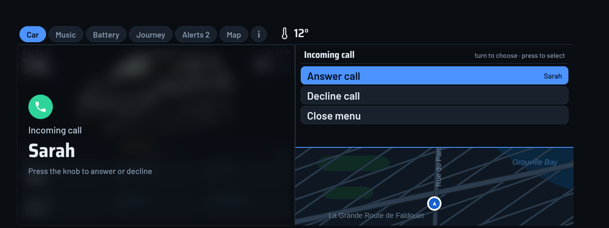

# i3D screenshots

These are renders of the real car page (`index.html`) at the car's 1440×540 size, fed with **sample data** (78% battery, 30 mph, a Spotify track, three notifications, twelve sample trips). They are not photos from a car.

Two things to know:

- The map behind the pages is **drawn for the mockup** (the render sandbox has no internet). In the car it is the live 3D map, loaded through the phone.
- The **entry screen** and **phone home screen** are illustrative mockups. The car draws its own list, and the phone screen is drawn to match the layout, so real fonts and spacing will differ slightly.

## On the car screen

### Car
Battery, speed, range, the car picture and the journey tiles.

### Music
Now playing, with cover art when the music app provides it.

### Battery

### Journey
Trip history and the cost of each journey.

### Alerts
Recent phone notifications. The number on the tab is the count.

### Car colour

### Map

### Navigating
Next turn, now-playing strip and the arrival bar.

### Incoming call
Press the knob to answer or decline.

### Call in progress
Press the knob to hang up.

## The menu

Press the knob anywhere in the dash and the menu opens at the top right. The map stays live underneath it, in the bottom right, with your next turn, arrival time and the speed limit. The menu shows four rows at a time and scrolls as you turn the knob. Turn to choose, press to select. These are renders of the real menu.

### While navigating

### On the Map page
The map keeps the whole screen and the menu sits over its top right corner.

### Main menu

### Navigate
Saved places, the nearest charger, recent places, and typing on the car's letter wheel.

### Call
Your starred contacts, or type a name.

### Music
Pressing the knob on the Music page opens this directly.

### Music: pick an app

### Music: pick a playlist

### Incoming call

## Finding it in the car (mockup)
i3D in the car's ConnectedDrive list. Choosing it opens the dash directly.

## On the phone (mockups)

### Home

### Send to car

