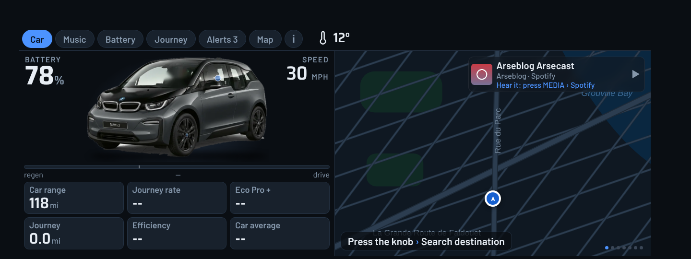
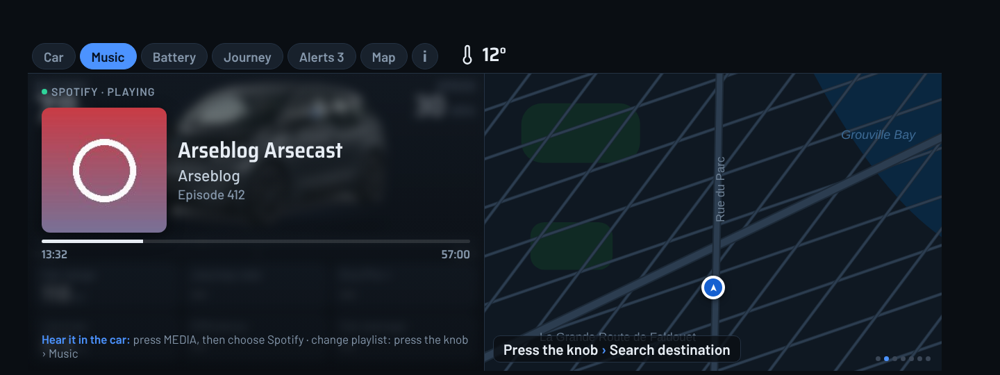
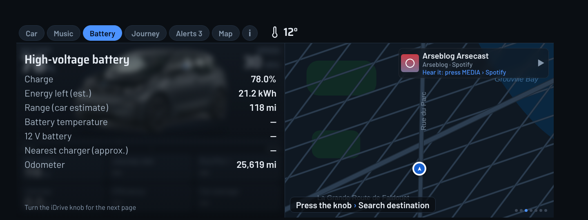
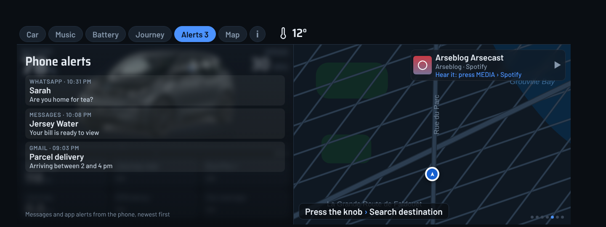
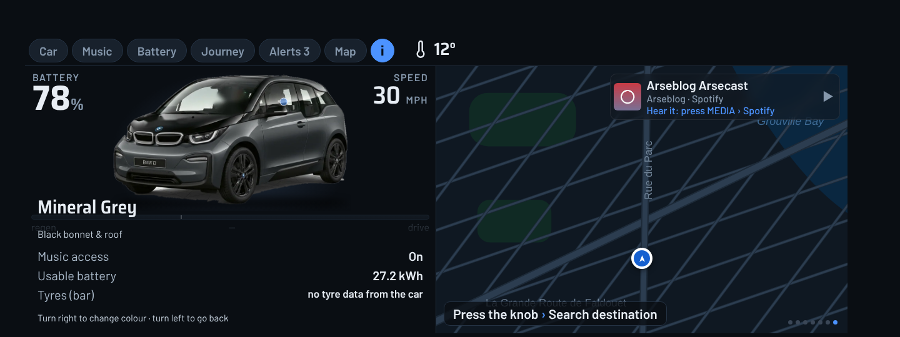
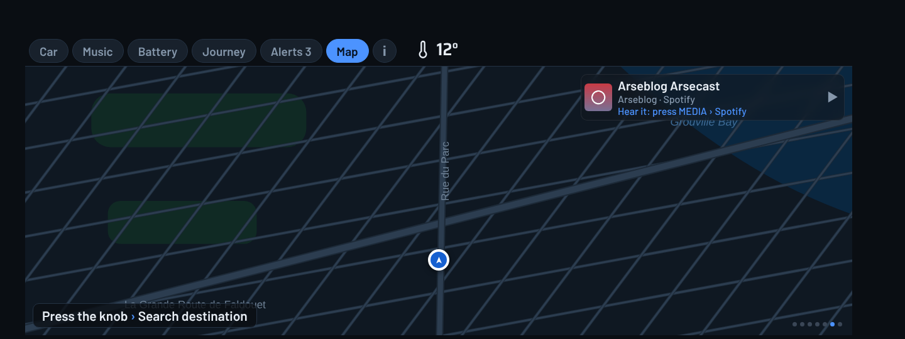
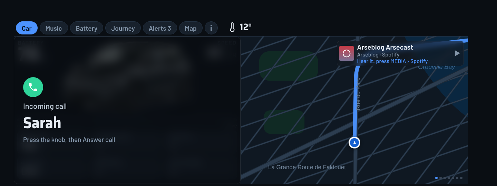
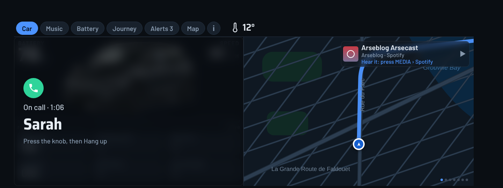
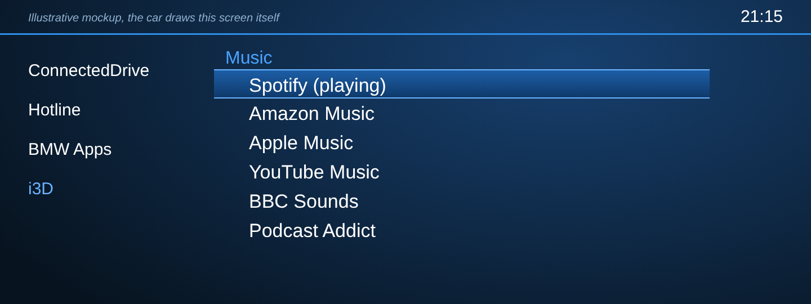

# i3D screenshots

These are renders of the real car page (`index.html`) at the car's 1440×540 size, fed with **sample data** (78% battery, 30 mph, a Spotify track, three notifications, twelve sample trips). They are not photos from a car.

Two things to know:

- The map behind the pages is **drawn for the mockup** (the render sandbox has no internet). In the car it is the live 3D map, loaded through the phone.
- The **car menu** and **phone home screen** are illustrative mockups. The car draws its own menu, and the phone screen is drawn to match the layout, so real fonts and spacing will differ slightly.

## On the car screen

### Car
Battery, speed, range, the car picture and the journey tiles.

### Music
Now playing, with cover art when the music app provides it.

### Battery

### Journey
Trip history and the cost of each journey.

### Alerts
Recent phone notifications. The number on the tab is the count.

### Car colour

### Map

### Navigating
Next turn, now-playing strip and the arrival bar.

### Incoming call
Press the knob, then Answer call.

### Call in progress
Press the knob, then Hang up.

## Car menus (mockups)

### Finding it
i3D in the car's ConnectedDrive list, with its icon.

### The i3D menu
Open the dash, search a place or contact, answer or hang up during a call, a Places and calls list, and Music.

### Music: pick an app
Press the knob on Music, then turn it through your streaming apps. The one playing is at the top.

### Music: pick a playlist
Press an app and its own library opens (playlists, liked songs, albums). Press a playlist to play it. Back is the first row.

## On the phone (mockups)

### Home

### Send to car

