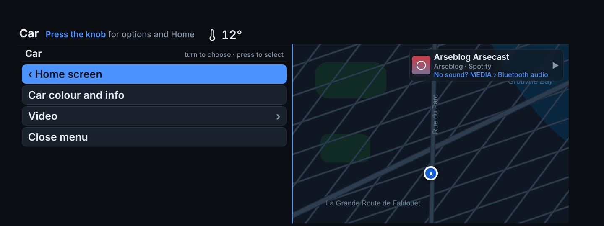
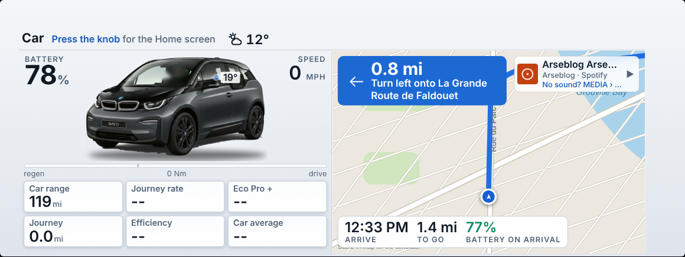
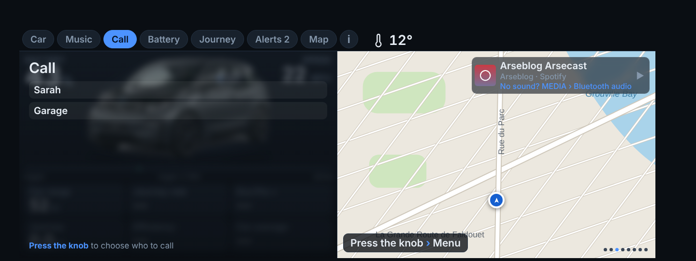
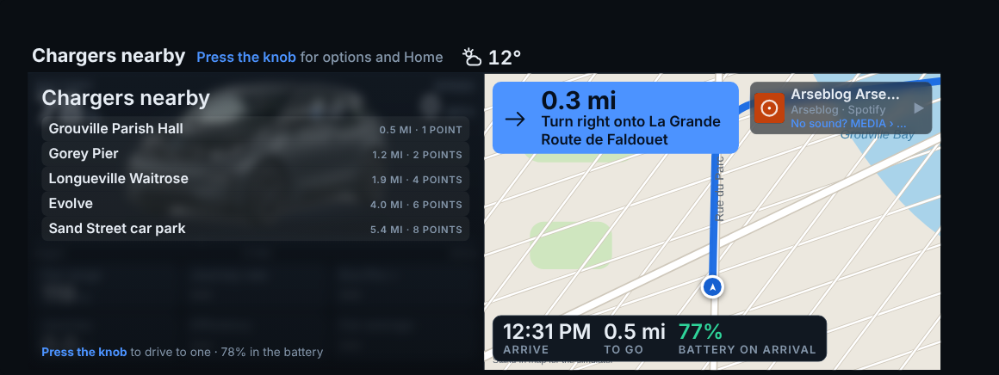

# i3D screenshots

These are renders of the real car page (`index.html`) at the car's 1440×540 size, fed with **sample data** (43% battery, 22 mph, a Spotify track, sample contacts and alerts). They are not photos from a car.

Two things to know:

- The map is **drawn for the pictures**, because the render sandbox has no internet. In the car it is the live 3D map, loaded through the phone. The pictures do show the real day and night switch.
- The **entry screen** and **phone home screen** are illustrative mockups. The car draws its own list, and the phone screen is drawn to match the layout, so real fonts and spacing will differ slightly.

## Home screen
What you see when i3D opens. Turn the knob to choose a card, press to open it.

## Lists
Press the knob inside a section for its list. It takes the left half and the map stays on the right. Every list starts with "‹ Home screen".

### Navigate

### Call
Favourites, recent calls, all contacts, or type a name.

### Choosing a number
Shown when a contact has more than one.

### Music

### Car

### During a call
Hang up is first.

## Sections
Each shows its name at the top and what the knob does there.

### Car

### Car, by day

### Navigating
Next turn, now-playing strip and arrival bar.

### Music

### Call

### Call in progress
Name, number and running time. Press the knob to hang up.

### Incoming call
Press the knob to answer or decline.

### Chargers
The nearest charging points. Press the knob to drive to one.

### Journey

### Alerts

### Map

### Car colour

## Finding it in the car (mockup)
i3D in the car's ConnectedDrive list. Choosing it opens the dash directly.

## On the phone (mockups)

### Home, with the setup list

### Send to car

