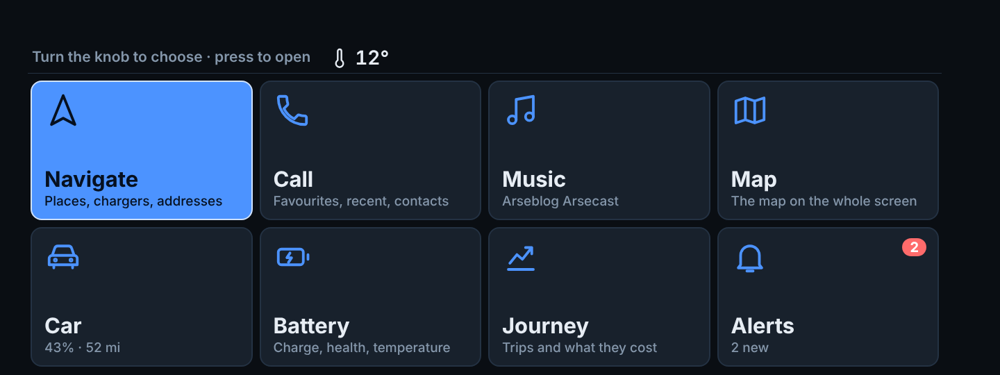
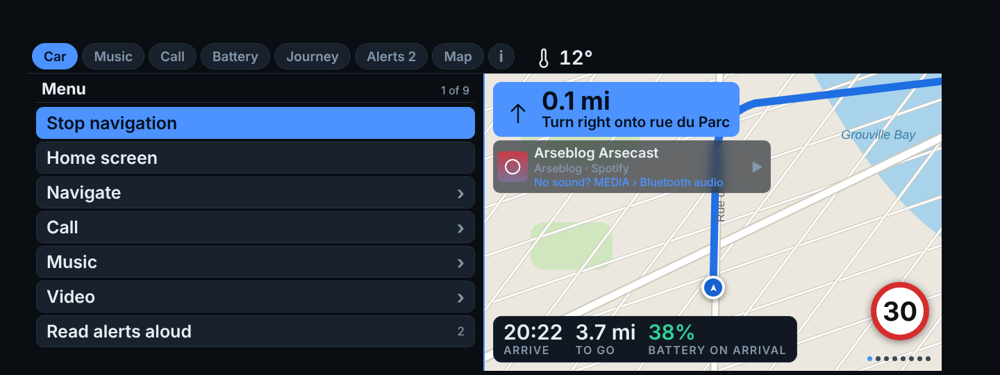
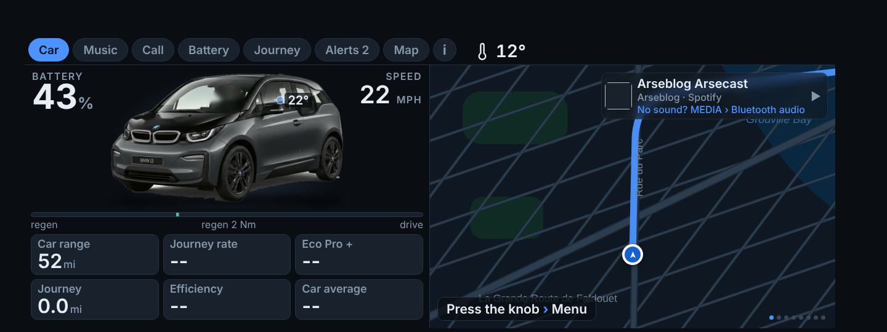
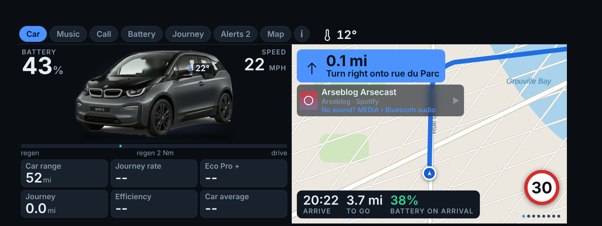
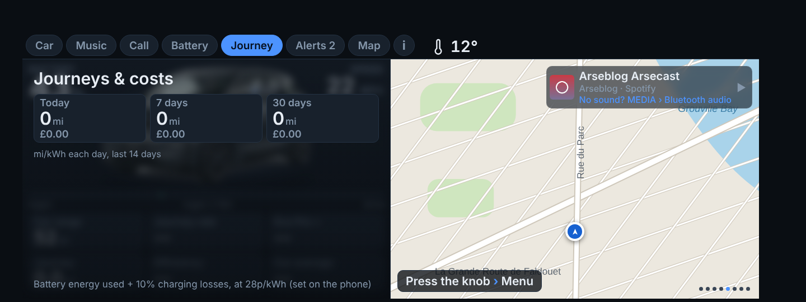
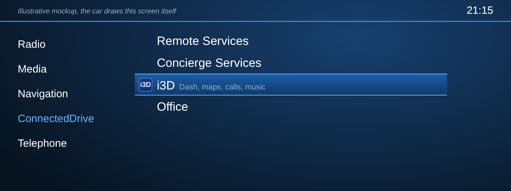
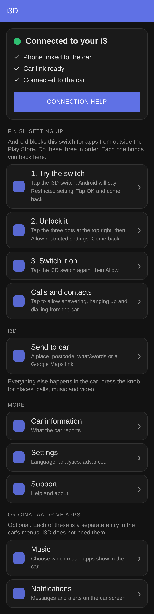
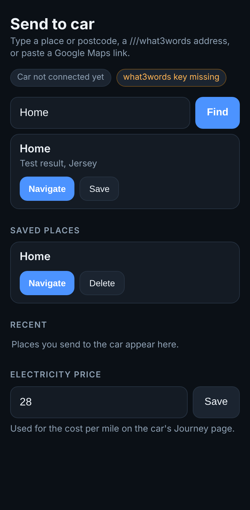

# i3D screenshots

These are renders of the real car page (`index.html`) at the car's 1440×540 size, fed with **sample data** (43% battery, 22 mph, a Spotify track, two notifications). They are not photos from a car.

Two things to know:

- The map is **drawn for the pictures**, because the render sandbox has no internet. In the car it is the live 3D map, loaded through the phone. The pictures do show the real day and night switch.
- The **entry screen** and **phone home screen** are illustrative mockups. The car draws its own list, and the phone screen is drawn to match the layout, so real fonts and spacing will differ slightly.

## Home screen
What you see when i3D opens. Turn the knob to choose a card, press to open it.

## The menu
Press the knob inside any section. The menu takes the left half and the map stays on the right.

### While navigating

### Main menu
Home screen is the first row.

### Navigate

### Call
Favourites, recent calls, all contacts, or type a name.

### Music

### Music: pick a playlist

### Incoming call

### On the Map page
The map gives up its left half only while the menu is open.

## Sections

### Car, by day

### Car, at night

### Navigating
Next turn, now-playing strip, arrival bar and speed limit.

### Music

### Call

### Battery

### Journey

### Alerts

### Map

### Car colour

### Incoming call
Press the knob to answer or decline.

### Call in progress
Press the knob to hang up.

## Finding it in the car (mockup)
i3D in the car's ConnectedDrive list. Choosing it opens the dash directly.

## On the phone (mockups)

### Home, with the setup list

### Send to car

