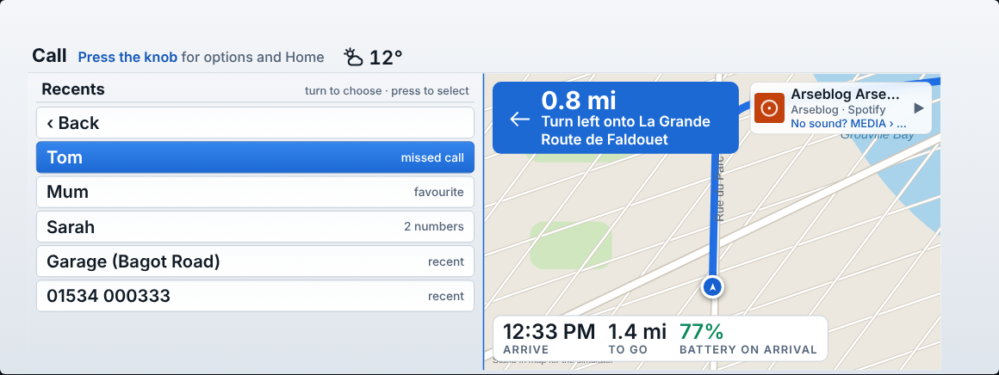
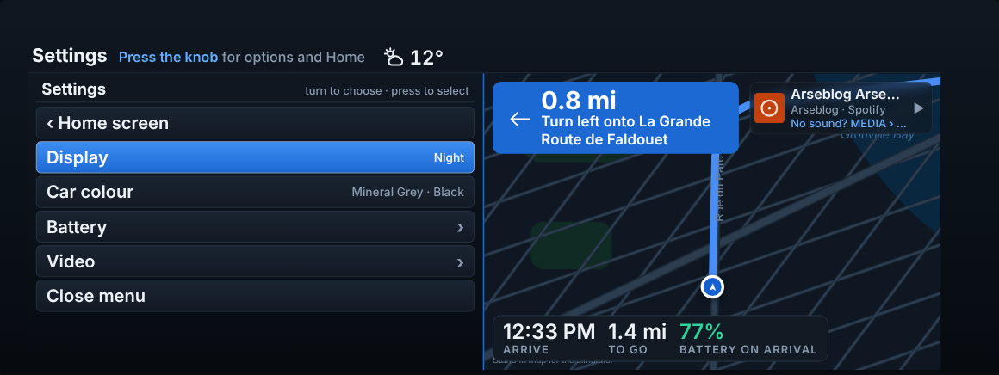
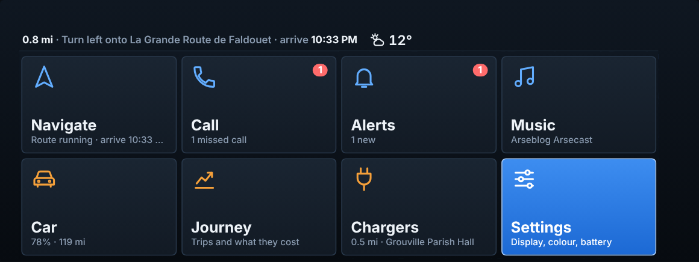

# i3D screenshots

These are renders of the real car page (`index.html`) at the car's 1440×540 size, fed with **sample data** (43% battery, 22 mph, a Spotify track, sample contacts and alerts). They are not photos from a car.

Two things to know:

- The map is **drawn for the pictures**, because the render sandbox has no internet. In the car it is the live 3D map, loaded through the phone. The pictures do show the real day and night switch.
- The **entry screen** and **phone home screen** are illustrative mockups. The car draws its own list, and the phone screen is drawn to match the layout, so real fonts and spacing will differ slightly.

## Home screen
What you see when i3D opens. Turn the knob to choose a card, press to open it.

## Menus
Press the knob inside a section for its menu. It takes the left half and the map stays on the right, and always has a way back to the Home screen.

A few options to choose between show as cards, the same way the Home screen does. A list you might scroll through - contacts, chargers, places - stays a list.

### Navigate
A list: places don't fit as cards.

### Call
Cards: Recents, Speak a name, All contacts, Type a name.

### Recents
Favourites, missed and recent calls together - a list, opened from the Recents card.

### Choosing a number
Shown when a contact has more than one.

### Music
Cards: your apps first, with **Resume** - what was last playing - as a later card, not the first thing offered.

### During a call
A short list. Hang up is first.

## Sections
Each shows its name at the top and what the knob does there.

### Car

### Navigating
Next turn, now-playing strip and arrival bar.

### Music

### Call

### Call in progress
Name, number and running time. Press the knob to hang up.

### Incoming call
Press the knob to answer or decline.

### Chargers
The nearest charging points, nearest first. Press the knob to drive to one. With an Open Charge Map key saved on the phone, it also shows what's reported available, as here - without one, just the location and point count.

### Journey

### Alerts

### Settings
Press the knob for its menu: the display mode, car colour, battery detail and video. It's the home for the smaller, less-used things.

### The Settings menu

### At night

## Finding it in the car (mockup)
i3D in the car's ConnectedDrive list. Choosing it opens the dash directly.

## On the phone (mockups)

### Home, with the setup list

### Send to car

